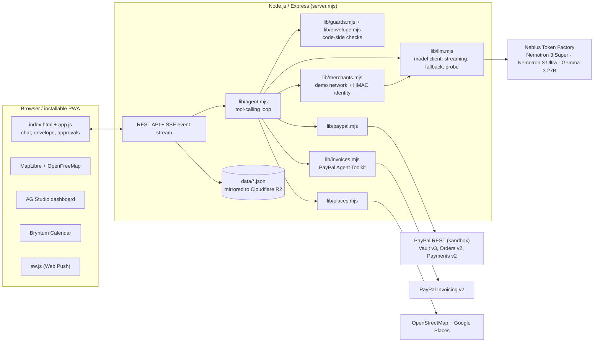

# Mandat — an AI agent you can trust with a budget, on NVIDIA Nemotron

**Tell it what you want and how much you can spend. Mandat searches real places, negotiates with merchants' agents, books, and holds deposits with PayPal, never a cent over your mandate.** Its brain is **NVIDIA Nemotron**, served by **Nebius Token Factory**.

Built for the Nebius × NVIDIA Global AI Hackathon (track: *Best Apps and Agents*). Payments run on the **PayPal sandbox**: no real money moves.

- Hosted demo: **https://mandat-nebius.onrender.com** (PayPal sandbox)
- Models: **Nemotron 3 Super** (the agent), **Nemotron 3 Ultra** (reviews every plan, takes over when a call fails), Gemma 3 27B (photos), all through Token Factory's OpenAI-compatible API
- Stack: Node.js 20+, Express, plain HTML/CSS/JS (installable PWA), PayPal Server SDK + Agent Toolkit, Google Places, OpenStreetMap, Channel3, AG Studio, Bryntum Calendar

---

## Try it in 3 minutes

Open **https://mandat-nebius.onrender.com** on a phone (it installs as an app) or a desktop browser. No sign-up: your browser gets its own private space. The screen says which model runs the agent: *Runs on NVIDIA Nemotron 3 Super via Nebius Token Factory*.

1. **Sign the mandate (30 s).** Tap *Continue with PayPal*, pick an autonomy level (*Careful* shows every approval), and log in on the PayPal sandbox page with **any PayPal sandbox Personal account** (developer.paypal.com → *Testing Tools* → *Sandbox Accounts*; never a real PayPal login).
2. **Give it an errand (1 min).** Type, in English or French:
   > *My mum turns 60 on Saturday: dinner for 8 around 8pm near Rue Oberkampf, Paris 11e, a birthday cake delivered to the restaurant, and flowers. 550 € max.*

   Mandat asks its few key questions **in one message** with tap answers. Tap one: it starts working on its own.
3. **Watch it work (1 min).** Real restaurants on the map, the restaurant agent's identity checked, a negotiation with it (group discount), and when the restaurant offers another time, **Mandat asks you** with one button per time. Then a PayPal sheet: *Hold to approve*. The deposit is **held**, not charged.
4. **Let it finish.** The cake and the flowers are ordered from local merchants of the network, delivered to the restaurant. Merchants without an AI agent answer by themselves in under a minute in this demo. A recap card closes the mission; *Activity* shows every payment like a bank statement and *Agenda* every booking.

The first visit after a quiet period can take a few seconds while the server wakes up.

## Built on NVIDIA Nemotron and Nebius Token Factory

| Role | Model (Token Factory id) | Why this one |
|---|---|---|
| **The agent**: a tool-calling loop of 31 tools (search, verify, negotiate, request, hold, void, refund, move a booking, buy, split, remember, plan) | **Nemotron 3 Super** `nvidia/nemotron-3-super-120b-a12b` | 12B active parameters: fast tool calls for a voice-first app, and on our end-to-end bench it reached the same bookings and books as our previous model. |
| **The merchant agents** (each demo merchant negotiates inside its own private rules) | Nemotron 3 Super | Many short JSON turns. |
| **The senior planner** that reviews every plan before money moves (`reviewPlan`) | **Nemotron 3 Ultra** `nvidia/Nemotron-3-Ultra-550b-a55b` | Deep reasoning where it matters. Measured on 6 plans × 3 runs (`scripts/bench-review.mjs`): **Ultra found 18/18 real problems and invented none**; Super found 16/18 and invented one, for 1.5 s less (median 6.2 s vs 4.7 s). |
| **Fallback**: a call that times out or errors moves once to the other model | Nemotron 3 Ultra / Super | A mission never freezes. |
| **Photos** (a broken bike, a receipt) | Gemma 3 27B `google/gemma-3-27b-it` | No Nemotron vision model is served on Token Factory. |

**Where Token Factory accelerated our work**

- **One client, any model.** Token Factory speaks the OpenAI chat-completions API, tools included (`tool_choice: "required"` too). Moving the agent to Nemotron was a base URL, a key and a model name (`lib/llm.mjs`); no SDK.
- **Benching models side by side.** `/v1/models` lists every model, so the same mission could run on Nemotron 3 Super, Ultra, 3.5 Lightning and Nano 30B (`scripts/bench-provider.mjs`) and the same plans through two reviewers (`scripts/bench-review.mjs`). The choices in the table above come from those runs, not from guesses.
- **One endpoint for text and photos**: Nemotron and Gemma behind the same key.

**What we had to add for an open model to handle money: the model proposes, the code decides.** Every guardrail below is code, tested (`npm test`) and measured on real missions:

- *Exact calendar*: the next 15 days (weekday + date) are injected at every turn and given to the reviewer, so "this Saturday" is read, never computed.
- *One deposit per booking*, the mandate and the daily limit checked before any PayPal call (`lib/envelope.mjs`), totals recomputed from the quote lines.
- *Another time is the user's call*: when a merchant agent offers other times than the one asked, the code stops any booking or hold there until the user taps one (`lib/guards.mjs`).
- *One round of questions*: the key questions come together; once answered, the next call must use a tool, so the agent acts instead of asking again.
- *Local things from local merchants*: a cake or flowers are ordered from a bakery or florist of the network, never searched as shipped products.
- *Clean words*: a reply where the model thinks out loud, several answer lines, a wrong language or wrong arithmetic is rewritten before anyone reads it. A title follows the language of the request.
- *Say only what the tools confirmed*: the books shown to the user always come from code.

## The problem

Handing an errand to an AI agent ("book dinner for six on Saturday, get a cake and flowers, 300 € max") is easy to say and hard to trust. Today an agent either cannot pay at all, so you finish every booking yourself, or it gets a card with no real limit and no record of what it did.

Mandat is for people who want the errand done but keep control of the money: a **signed PayPal mandate**, a **budget envelope per mission**, deposits that are **held rather than charged**, approvals at the level of autonomy you choose, and a ledger of every movement.

## What it does

| Feature | How it works |
|---|---|
| **Sign a mandate once** | One trip to PayPal saves your PayPal account with **Vault v3** (setup token, then payment token). That trip also connects your account (name and email come back with the token). You set a monthly limit and an autonomy level. |
| **One budget envelope per mission** | Each mission has its own envelope: total / held / paid / remaining. Every payment is checked against it first (`lib/envelope.mjs`), and the monthly limit is checked when a mission is created. |
| **Ask by text, voice, or photo** | Type, speak, or attach a photo (a receipt, a broken scooter, a character a child loves). Voice is recorded in the page and transcribed by Google Speech-to-Text; replies are read with a neural Google voice (Chirp 3 HD), only when you spoke. The photo is read once by the model and kept as a text description. |
| **Real places, any city** | Real places from Google Places (rating, reviews, photos the agent looks at before choosing) and OpenStreetMap (addresses, transit lines), on an interactive map (MapLibre + OpenFreeMap). The merchant network opens in any city the first time it is asked for. |
| **Negotiation with merchant agents** | Bookings go through a demo merchant network. Merchants that run an AI agent quote and negotiate (availability, discounts, counter-offers) inside their own private rules, and the exchange is shown live. |
| **Know Your Agent** | Before negotiating or paying, the buyer agent checks the merchant agent's identity card, signed by the network with HMAC-SHA256 (`verify_merchant`). |
| **Booking requests for merchants without AI** | For small merchants with no agent, Mandat sends a structured booking request (items from their catalogue, slot, deposit) to a **private merchant inbox** (`/merchant/:id?k=…`, an HMAC-signed link; in production it would arrive by SMS or email). The merchant taps **Accept**, **Other time** (counter-proposal) or **Decline** — no app, no AI on their side. After they accept, the shopper's agent holds the deposit with PayPal; the merchant then taps **Confirm & collect** and the deposit is captured. |
| **Holds, not charges** | Deposits are PayPal **authorizations** (Orders v2, `intent: AUTHORIZE`) paid with the vaulted token, so the money is reserved, not spent. If the plan changes, the agent **voids** the authorization. |
| **Approvals by autonomy level** | *Careful* asks before every payment, *Balanced* pays small deposits alone and asks above your limit, *Autopilot* acts on its own inside the mission budget and reports each step. A **daily limit** across all missions still applies: above it, the agent must ask. Pending payments appear as an Approve / Decline sheet. |
| **Split the bill** | Exact to the cent (`lib/split.mjs`): equal or unequal shares, rounding cents assigned to whoever paid. Each friend gets a **detailed PayPal invoice** (bill lines with their part, who paid, where, when, how it was split) with a pay link and a **QR code**. PayPal also emails it when an address is known. Paid invoices show up in the mission. |
| **Notifications** | Web Push (VAPID) only for moments that need you: approvals, a question from the agent, a merchant accepting or declining, a friend paying, a mission fully booked. Nothing is sent while you are looking at that mission. |
| **Shopping with photos checked** | Real products from 25,000+ retailers through **Channel3**: Mandat searches, looks at the photos of the best candidates against the need ("a gift for an 8-year-old who loves Stitch"), drops what does not fit, offers the two best with their real difference, and pays with PayPal. |
| **Agenda driven by the agent** | Every dated step of every mission in a **Bryntum Calendar**. Moving an event asks Mandat to move the booking with the merchant (`move_booking`): same booking, no new payment, and it only changes once the merchant agrees. |
| **Spending dashboard with its own agent** | The Activity tab is an **AG Studio** dashboard built from the books (paid, held, still to pay, budget left, where the money goes, every payment with its PayPal reference). Its assistant is AG Studio's agent framework running on Mandat's model, with a tool that reads the books as the app computes them. |
| **Stop switch** | One toggle freezes all payments for every mission, and each mission also has its own stop button. A mission that still holds money cannot be deleted. |

No sign-up: each browser gets its own private space through an HTTP-only cookie.

## How PayPal is used

| PayPal API / product | Where in the code | Why |
|---|---|---|
| **[PayPal Server SDK](https://github.com/paypal/PayPal-TypeScript-Server-SDK)** (`@paypal/paypal-server-sdk` 2.5.0, generated by APIMatic) | `lib/paypal.mjs` | Every call below goes through the official SDK: one `Client` (OAuth 2.0 client credentials handled by the SDK), and the `VaultController`, `OrdersController` and `PaymentsController` with typed request models. Integrated with the **APIMatic Context Plugin for PayPal**, whose skills set the rules we follow: pinned version, a per-attempt timeout, typed `CustomError` mapping, and retries that include POST only because every write is idempotent. |
| **Vault v3: setup tokens** (`VaultController.createSetupToken`) | `lib/paypal.mjs` → `createMandateSetup()`, called by `POST /api/me/mandate` | Starts the mandate: the user approves once on PayPal (`usageType: MERCHANT`, `customerType: CONSUMER`). |
| **Vault v3: payment tokens** (`VaultController.createPaymentToken`) | `lib/paypal.mjs` → `activateMandate()`, called by `GET /mandate/return` | Turns the approved setup token into a reusable payment token. That token **is the mandate**: the agent can pay without the user being present. |
| **Orders v2** (`OrdersController.createOrder`, `intent: AUTHORIZE`, `paymentSource.paypal.vaultId`) | `lib/paypal.mjs` → `hold()`, used by the agent tool `hold_deposit` through `doHold()` in `lib/agent.mjs` | Holds a deposit for an agreed offer. The money is reserved, not captured. |
| **Payments v2: capture / void / refund** (`PaymentsController.captureAuthorizedPayment`, `voidPayment`, `refundCapturedPayment`) | `lib/paypal.mjs` → `capture()`, `release()`, `refund()`; `captureEntry()` and the tools `cancel_hold` / `refund_payment` in `lib/agent.mjs`; `POST /api/merchants/:mid/requests/:rid/collect` in `server.mjs` | Capture when the merchant confirms (instantly for merchants with an agent, from the inbox for the others); void when the plan changes before that; refund after capture when a booking is cancelled. |
| **Invoicing v2 via the official [PayPal Agent Toolkit](https://github.com/paypal/agent-toolkit)** (`@paypal/agent-toolkit`): `create_invoice`, `send_invoice`, `generate_invoice_qr_code`, `get_invoice` | `lib/invoices.mjs` → `shareInvoice()`, `invoiceStatus()`; used by the agent tool `split_bill` and by a background check every 2 minutes in `server.mjs` | One real, itemised invoice per friend, with a pay link and a QR code. The toolkit's tools are called in the OpenAI tool-call shape (`handleToolCall`), exactly as an agent framework would. |
| **Idempotency** (`PayPal-Request-Id`, the SDK's `paypalRequestId`) | `lib/paypal.mjs` | Every money-moving call carries a fresh idempotency key, so a retry can never charge twice. |

**Sandbox app features to enable** (developer.paypal.com → your sandbox app): **Save payment methods** (Vault) and **Invoicing**.

**Offline mode:** without PayPal keys the app still runs. Every PayPal call returns the same shape with fake ids and `mode: "offline"`, and the UI labels it "Demo mode" so it never pretends money moved.

## Architecture



## Run locally

**Requirements:** Node.js 20 or newer, a **Nebius Token Factory API key** (tokenfactory.nebius.com), and (optionally) a PayPal sandbox app.

```bash
git clone --branch nebius https://github.com/blanco1er/mandat.git
cd mandat
npm install
cp .env.example .env    # then set NEBIUS_API_KEY (and the optional keys below)
set -a; source .env; set +a
npm test                # code-side guardrails
npm start               # http://localhost:8790
```

| Variable | Required | Purpose |
|---|---|---|
| `NEBIUS_API_KEY` | **yes** | Token Factory key: the agent, the merchant agents, the plan review, photo reading. Without it the server starts but the agent cannot answer. |
| `LLM_BASE_URL`, `LLM_FAST_MODEL`, `LLM_SMART_MODEL`, `LLM_VISION_MODEL`, `LLM_REVIEW_MODEL` | no | Defaults: Token Factory, Nemotron 3 Super, Nemotron 3 Ultra, Gemma 3 27B, Ultra. Any OpenAI-compatible endpoint works. |
| `PAYPAL_CLIENT_ID`, `PAYPAL_CLIENT_SECRET` | recommended | PayPal **sandbox** app keys. Without them the app runs in a clearly labelled offline demo mode. |
| `PUBLIC_URL` | when hosted | Public https base URL (PayPal return URLs, invoice links). |
| `GOOGLE_PLACES_KEY` | no | Real place photos and ratings, speech-to-text and the neural voice. |
| `CHANNEL3_API_KEY` | no | Real product search and shopping. |
| `AG_STUDIO_LICENSE_KEY` | no | Removes the AG Studio trial watermark. |
| `R2_ACCOUNT_ID`, `R2_ACCESS_KEY_ID`, `R2_SECRET_ACCESS_KEY`, `R2_BUCKET`, `R2_PREFIX` | no | Keeps `data/` in a Cloudflare R2 bucket across restarts. |
| `MANDAT_LLM_BUDGET_USD` | no | A hard ceiling for the model bill (USD). Every call's cost is counted from its tokens (`lib/spend.mjs`, kept in `data/llm-spend.json`); past the ceiling no call leaves the server and the app says the agent is paused, while missions, payments and agenda stay available. |
| `MANDAT_MERCHANT_DELAY` | no | How fast demo merchants without an AI agent answer (1 = 20 to 50 s, 0.4 = 8 to 20 s). |
| `MANDAT_TURNS_PER_USER_DAY`, `MANDAT_MISSIONS_PER_USER_DAY`, `MANDAT_TURNS_PER_DAY`, `MANDAT_WRITES_PER_MINUTE` | no | Public-demo guards (defaults 80, 15, 3000, 40) that keep the model bill bounded while judges test. |
| `VAPID_PUBLIC_KEY`, `VAPID_PRIVATE_KEY`, `VAPID_SUBJECT`, `MANDAT_NETWORK_SECRET`, `PORT`, `MANDAT_DATA` | no | Web Push keys (generated if absent), network signing key, port, data directory. |

**Signing the mandate in the sandbox.** Log in with a **sandbox personal (buyer) account** from *Testing Tools → Sandbox Accounts* on developer.paypal.com. Never use a real PayPal login. In the sandbox app, enable **Save payment methods** and **Invoicing**.

**Benches.** `node scripts/bench-provider.mjs [birthday|repair]` runs one realistic mission end to end without the UI (PayPal offline, every payment approved) and prints the books; `node scripts/bench-review.mjs [reps]` compares plan reviewers (`BENCH_MODELS=a,b`).

## Deploy on Render

The Blueprint [`render.yaml`](render.yaml) describes the `mandat-nebius` web service (branch `nebius`, Starter plan, Frankfurt), with the Token Factory endpoint and models already set.

1. On Render: **New → Blueprint**, select this repository and the `nebius` branch.
2. Paste the secrets it asks for: `NEBIUS_API_KEY`, `PAYPAL_CLIENT_ID`, `PAYPAL_CLIENT_SECRET`, `GOOGLE_PLACES_KEY`, `CHANNEL3_API_KEY`, the R2 keys; `MANDAT_NETWORK_SECRET` is generated.
3. Health check: `GET /api/health` answers `{"ok":true, "ai":{"model":"NVIDIA Nemotron 3 Super","host":"Nebius Token Factory"}, …}`.

`data/` is mirrored to Cloudflare R2 (`R2_PREFIX=nebius/`) and restored at start, so accounts and missions survive a redeploy.

## Tools used

| Tool | Used for |
|---|---|
| **NVIDIA Nemotron 3 Super and Nemotron 3 Ultra** on **Nebius Token Factory** | The agent, the merchant agents, the plan review, titles, the dashboard assistant |
| **Gemma 3 27B** on Nebius Token Factory | Reading photos |
| **PayPal Server SDK** (`@paypal/paypal-server-sdk`, sandbox): Vault v3, Orders v2, Payments v2 | Mandate, deposit holds, captures on confirmation, voids, refunds |
| **PayPal Agent Toolkit** (`@paypal/agent-toolkit`) | Invoicing v2 tools for split bills |
| **OpenStreetMap** (Nominatim + Overpass) and **Google Places API (New)** | Real places, ratings, reviews and photos |
| **MapLibre GL JS + OpenFreeMap** | Interactive map inside the conversation |
| **Channel3 API** | Real products for things to buy |
| **AG Studio** and **Bryntum Calendar** | Activity dashboard and its assistant; Agenda |
| **Google Cloud Text-to-Speech and Speech-to-Text** | The voice of Mandat, and what you say |
| **Web Push** (VAPID) + Service Worker | Notifications |
| **Express**, **Render**, **Cloudflare R2** | Server, hosting, durable data |

## Safety

- **Never over budget.** Every hold goes through `Env.check()`: if the amount is more than what is left in the mission's envelope, it is refused in code, whatever the model asks. Booking requests the envelope cannot pay are never sent, and a new mission cannot push you past your monthly limit.
- **Holds before captures.** Deposits are authorizations, not charges, and a changed plan voids them. A mission with money still held cannot be deleted.
- **You decide how much it may do alone.** Payments above your autonomy threshold wait for your tap.
- **Stop switch.** It works globally and per mission, and blocks every new payment immediately.
- **Know Your Agent.** The merchant agent's identity card is verified before negotiating or paying.
- **Secrets never in the repo.** Keys come from environment variables or from private `chmod 600` files outside the project, and they are never logged. `.env`, `*.key` and `data/` are gitignored.
- **Minimal data.** From PayPal, Mandat stores only the payer's name, email and the vault payment token id. The user can see "What Mandat knows" and erase it in Settings.

## Sandbox disclaimer

This is a hackathon demo. **All payments use the PayPal sandbox. No real money moves.** The merchants of the Mandat network (Lumière, L'Ombre Rouge, Atelier Sucré, Pivoine and the ones it opens in new cities) are fictional demo merchants. The places on the map are real (OpenStreetMap, Google Places), but bookings only go to the demo network.

## License

[MIT](LICENSE) © 2026 Blanco
